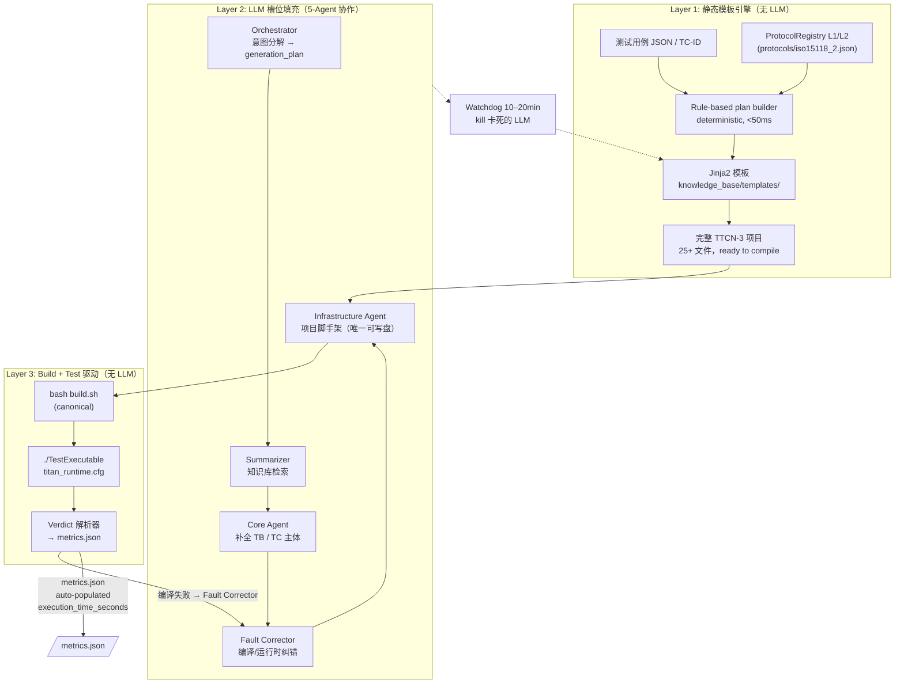

# ISO 15118-2 TTCN-3 测试代码自动生成系统

基于多 Agent 协作的端到端流水线：把 ISO 15118-2 安全需求（V2G2-XXX）自动转化为符合 ISO 15118-4 规范的 TTCN-3 一致性测试代码，并可直接用 Eclipse TITAN 编译运行。

> **核心引擎**：Claude Code CLI（通过 `claude -p` 调用作为 sub-agent）
> **生成语言**：TTCN-3（Eclipse TITAN 编译运行）
> **数据源**：[`document/iso15118_4_ttcn_knowledge_base.json`](document/) — **771 个测试用例 + 124 个 module + 600 个 testcase 代码**（截至 2026-06）

---

## 目录

- [1. 目录结构](#1-目录结构)
- [2. 环境配置](#2-环境配置)
- [3. 运行：单测试用例](#3-运行单测试用例)
- [4. 运行：批量（知识库中的所有测试用例）](#4-运行批量知识库中的所有测试用例)
- [5. Multi-Agent 工作流程](#5-multi-agent-工作流程)
- [6. 输出与产物](#6-输出与产物)
- [7. 常见问题](#7-常见问题)

---

## 1. 目录结构

```
agent/
├── document/                                     # 协议文档与预处理数据
│   ├── iso15118_2_hierarchical_tree.json          # ISO 15118-2 结构化知识库
│   ├── iso15118_4_ttcn_knowledge_base.json        # ⭐ ISO 15118-4 TTCN-3 知识库（771 个 TC）
│   ├── MinerU_markdown_ISO_15118-*.md             # ISO 标准 PDF 提取的 markdown
│   └── iso15118_*_preprocessor.py                 # 知识库构建脚本
│
├── test_code/                                    # ⭐ Phase 2：TTCN-3 代码生成（核心入口）
│   ├── ttcn3_generation_pipeline.py               # 单 TC 主入口
│   ├── batch_runner.py                            # 批量入口
│   ├── prompts/                                   # 5 个 Agent Prompt 模板
│   ├── protocol_registry.py                       # 协议描述符注册表（Layer 2 静态渲染核心）
│   ├── ttcn_static_renderer.py                    # 静态模板渲染器（无 LLM，确定性 0.6s 出代码）
│   ├── knowledge_base/                            # SOP + 错误模式库 + Few-shot 索引
│   ├── fault_corrector/                           # 运行时双轨分析（PCAP + TITAN log）
│   ├── examples/                                  # Few-shot TTCN-3 样例 + 可运行 demo
│   ├── suites/                                    # 批量运行的 case 列表（JSON）
│   ├── protocols/iso15118_2.json                  # 当前协议快照 + 扩展队列 .review_queue/
│   └── generated/                                 # 单 TC 生成的代码输出目录
│
├── test_case/                                    # Phase 1：测试用例 JSON 生成（按需）
├── experiment/                                   # Phase 3：评估（论文用，与日常运行无关）
└── batch_results/                                 # 批量运行的 JSONL 结果（每次运行一个文件）
```

> 详细的三阶段流水线、Agent 架构、TTCN-3 命名规范可参考 [`test_code/plans/100_percent_unattended_pipeline.md`](test_code/plans/100_percent_unattended_pipeline.md)。

---

## 2. 环境配置

### 2.1 最小环境（仅生成代码）

```bash
# 1. Python 3.8+（agent/ 仅用标准库）
python --version

# 2. Claude Code CLI + API Key
npm install -g @anthropic-ai/claude-code
export ANTHROPIC_API_KEY="sk-ant-xxxxx-xxxxxxxxxxxxx"
claude --version
```

### 2.2 完整环境（生成 + 编译 + 运行）

在最小环境基础上增加 Eclipse TITAN：

```bash
# Ubuntu/Debian（一键安装）
sudo apt update
sudo apt install eclipse-titan build-essential

# 验证
makefilegen --version
ttcn3-compiler --version
```

> Windows 推荐用 WSL（`wsl --install -d Ubuntu`）后跑上面的 Linux 命令。源码编译步骤见 `doc_urls.json` 的 `installationguide.adoc`。

### 2.3 环境变量速查

| 变量 | 必填场景 | 示例 |
|------|----------|------|
| `ANTHROPIC_API_KEY` | 所有 LLM Agent 调用 | `sk-ant-xxx` |
| `TTCN3_DIR` | 源码编译安装 TITAN 后 | `$HOME/TITAN` |
| `PATH` | 含 `$TTCN3_DIR/bin` | `export PATH=$TTCN3_DIR/bin:$PATH` |
| `LD_LIBRARY_PATH` | 源码编译安装后运行时 | `export LD_LIBRARY_PATH=$TTCN3_DIR/lib:$LD_LIBRARY_PATH` |

`apt` 安装时 TITAN 默认在 `/usr/bin`，无需额外配置。

---

## 3. 运行：单测试用例

**入口脚本**：[`test_code/ttcn3_generation_pipeline.py`](test_code/ttcn3_generation_pipeline.py)

**行为说明**（重要）：
- **Infrastructure Agent 始终运行**——每次调用都会生成完整 TITAN 项目结构（`config/` + `cpp_adapters/` + `build.sh` + TTCN 源码树）
- 加 `--skip-build` 则**只生成项目结构、不编译不运行**
- 不加 `--skip-build` 则**自动编译并运行**（`makefilegen` + `make` + 跑 TestExecutable）

支持 4 种输入模式，按需选择其一：

### 3.1 通过测试用例 ID 运行（最常用 ⭐）

```bash
cd agent

# 仅生成代码 + 项目结构（跳过编译运行，适合 review）
python test_code/ttcn3_generation_pipeline.py \
    --tc-id TC_SECC_CMN_VTB_SessionSetup_001 \
    --skip-build

# 完整：生成代码 + 项目结构 + 编译 + 运行
python test_code/ttcn3_generation_pipeline.py \
    --tc-id TC_SECC_CMN_VTB_SessionSetup_001
```

### 3.2 通过安全需求 ID 运行

```bash
# 内部自动跑 Phase 1 生成测试用例 JSON，再走 Phase 2 + 项目结构 + 编译 + 运行
python test_code/ttcn3_generation_pipeline.py \
    --requirement V2G2-082

# 多个需求合并为一个测试用例
python test_code/ttcn3_generation_pipeline.py \
    --requirements V2G2-082,V2G2-165,V2G2-434

# 每个需求单独生成测试用例
python test_code/ttcn3_generation_pipeline.py \
    --requirements V2G2-082,V2G2-165 --mode single
```

### 3.3 通过测试用例 JSON 运行

```bash
# 方式 A：JSON 字符串（生成 + 项目结构 + 编译 + 运行）
python test_code/ttcn3_generation_pipeline.py --test-case '{"Test_Case": {...}}'

# 方式 B：JSON 文件（推荐；可加 --skip-build 只生成项目结构不编译）
python test_code/ttcn3_generation_pipeline.py --test-case-file ./my_test_case.json
```

### 3.4 常用参数速查（来自 `python test_code/ttcn3_generation_pipeline.py --help`）

**输入模式**（4 选 1）：

| 参数 | 用途 | 示例 |
|------|------|------|
| `--tc-id` | 测试用例 ID（知识库 771 个之一） | `TC_SECC_CMN_VTB_SessionSetup_001` |
| `--requirement` | 单个安全需求 ID | `V2G2-082` |
| `--requirements` | 多个安全需求 ID，逗号分隔 | `V2G2-082,V2G2-165` |
| `--test-case` | 测试用例 JSON 字符串 | `'{"Test_Case": {...}}'` |
| `--test-case-file` | 测试用例 JSON 文件路径 | `./my_test_case.json` |
| `--filter-tc-id` | 从测试用例文件筛选特定 TC ID | `TC_SECC_CMN_VTB_V2GTPHeader_001` |

**配置选项**：

| 参数 | 用途 | 默认 |
|------|------|------|
| `--sut {SECC,EVCC}` | SUT 类型 | 自动推断 |
| `--mode {single,multi}` | 多需求时：单独 vs 合并 | `single` |
| `--no-auto-generate` | 未找到测试用例时不自动调 Phase 1 | 关 |
| `--no-llm-render` | 完全用静态模板（确定性，0.6s 出代码，无 LLM 调用） | 关 |
| `--watchdog-timeout` | LLM 子代理最大空闲秒数 | `1200`（20min） |
| `--rule-based-plan` | 用确定性 Python 规则构建 plan，跳过 Orchestrator LLM | 关 |

**编译运行选项**：

| 参数 | 用途 | 默认 |
|------|------|------|
| `--skip-build` | 跳过编译和运行（**仅生成代码和项目结构**） | 关 |
| `--sut-ip` | titan_runtime.cfg 的 SUT IP | `ff02::01`（IPv6 组播） |

**故障分析**：

| 参数 | 用途 |
|------|------|
| `--titan-log` | TITAN log 路径（Fault Agent 分析） |
| `--pcap` | PCAP 文件路径（双轨分析） |

---

## 4. 运行：批量（知识库中的所有测试用例）

**入口脚本**：[`test_code/batch_runner.py`](test_code/batch_runner.py)

> 知识库 [`document/iso15118_4_ttcn_knowledge_base.json`](document/) 当前收录 **771 个测试用例**，按 `message_type` 字段归入 **28 个核心 family**（ChargeParameterDiscovery、PowerDelivery、SDP、Authorization…）。最常用的 10 个 case 已在 [`test_code/suites/v2gtp_pilot_10.json`](test_code/suites/v2gtp_pilot_10.json) 里。

### 4.1 跑默认 pilot-10 suite

```bash
cd agent

# 1) Dry-run：先看一眼会跑哪些 case（不实际运行）
python test_code/batch_runner.py --dry-run

# 2) 正式跑（写入 agent/batch_results/batch_results.jsonl）
python test_code/batch_runner.py

# 3) 增量跑：跳过已经 pass 的（推荐长时间任务，中断后可续跑）
python test_code/batch_runner.py --resume
```

### 4.2 跑指定 TC 列表（不写 suite 文件）

```bash
# 直接给一组 TC ID，逗号分隔
python test_code/batch_runner.py \
    --tc-ids TC_SECC_CMN_VTB_SDP_001,TC_SECC_CMN_VTB_SessionSetup_001,TC_SECC_CMN_VTB_Authorization_001
```

### 4.3 跑知识库中**某个 family** 的所有 TC

知识库按 `message_type` 字段分了 28 个 family（ChargeParameterDiscovery、PowerDelivery、SDP、Authorization…）。下面示范"跑 ChargeParameterDiscovery 的所有 125 个 TC"：

```bash
# 步骤 1：把某个 family 的所有 TC ID 导出为 suite JSON
python3 - <<'PYEOF'
import json
with open('document/iso15118_4_ttcn_knowledge_base.json') as f:
    kb = json.load(f)

target_family = 'ChargeParameterDiscovery'  # 改这里
suite = [
    {"tc_id": r['tc_id'],
     "family": r['message_type'],
     "sut_type": r['sut_type'],
     "test_type": r['test_type']}
    for r in kb['tc_records']
    if r.get('message_type') == target_family
]
out = 'test_code/suites/charge_param_disc.json'
with open(out, 'w') as f:
    json.dump(suite, f, indent=2, ensure_ascii=False)
print(f"Wrote {len(suite)} TCs to {out}")
PYEOF

# 步骤 2：跑这个 suite
python test_code/batch_runner.py --suite test_code/suites/charge_param_disc.json
```

### 4.4 跑知识库中**所有 771 个 TC**（生产级跑分）

```bash
# 步骤 1：生成"全量" suite
python3 - <<'PYEOF'
import json
with open('document/iso15118_4_ttcn_knowledge_base.json') as f:
    kb = json.load(f)
suite = [
    {"tc_id": r['tc_id'],
     "family": r['message_type'],
     "sut_type": r['sut_type'],
     "test_type": r['test_type']}
    for r in kb['tc_records']
]
with open('test_code/suites/all_771.json', 'w') as f:
    json.dump(suite, f, indent=2, ensure_ascii=False)
print(f"Wrote {len(suite)} TCs")
PYEOF

# 步骤 2：跑全部（强烈建议加 --resume 防止中断后重跑）
python test_code/batch_runner.py \
    --suite test_code/suites/all_771.json \
    --resume \
    --per-case-timeout 1800
```

### 4.5 批量运行参数速查（来自 `python test_code/batch_runner.py --help`）

| 参数 | 用途 | 默认 |
|------|------|------|
| `--suite` | suite JSON 路径（`{tc_id, family, rationale}[]`） | `v2gtp_pilot_10.json` |
| `--tc-ids` | 逗号分隔的 TC ID 列表（覆盖 `--suite`） | — |
| `--output-dir` | 结果 JSONL 输出目录 | `agent/batch_results/` |
| `--results-name` | JSONL 文件名 | `batch_results.jsonl` |
| `--dry-run` | 只打印计划，不实际跑 | 关 |
| `--resume` | 跳过已有结果的 TC（增量跑） | 关 |
| `--per-case-timeout` | 每个 TC 墙钟超时（秒） | `1800`（30min） |
| `--no-clean-between` | 跳过 case 间的 `.claude/` 和 `/tmp/titan_build_*` 清理 | 关 |

### 4.6 批量结果查看

```bash
# 实时监控
tail -f agent/batch_results/batch_results.jsonl

# 统计 pass / fail / 延迟
python3 - <<'PYEOF'
import json
total = pass_ = fail_ = err_ = 0
secs = []
with open('agent/batch_results/batch_results.jsonl') as f:
    for line in f:
        rec = json.loads(line)
        total += 1
        s = rec.get('status', 'unknown')
        if s == 'pass': pass_ += 1
        elif s == 'fail': fail_ += 1
        else: err_ += 1
        secs.append(rec.get('latency', {}).get('total_pipeline_seconds', 0))
print(f"Total: {total}  pass: {pass_}  fail: {fail_}  error/timeout: {err_}")
if secs:
    print(f"Latency: min={min(secs):.1f}s  avg={sum(secs)/len(secs):.1f}s  max={max(secs):.1f}s")
PYEOF
```

---

## 5. Multi-Agent 工作流程

`test_code/ttcn3_generation_pipeline.py` 用 **3-Layer 神经-符号混合架构** 串联 5 个 Agent + 2 段 bash/Python 驱动。每个 Layer 都有清晰的所有权边界，避免"LLM 什么都写"导致的死锁和不可重现。

### 5.1 三层架构（端到端数据流）



**关键不变量**：
- **Layer 1 + Layer 3 永不调用 Claude API**（纯 Python/Jinja/bash）
- **Layer 2 是可选的**（`--no-llm-render` 走纯 Layer 1 → Layer 3，确定性 100%）
- **看门狗**覆盖 Layer 2 全部 LLM 进程；超时即 kill 并回退 Layer 1 输出

### 5.2 5 个 Agent 职责速查

| Agent | 职责 | 工具权限 | Prompt 模板 |
|-------|------|---------|-------------|
| **Orchestrator** | 解析测试用例 → generation_plan（tc_id / sut_type / precondition_chain / port / template 名称 / 计时器） | **Read-only** | `orchestrator_prompt.txt` |
| **Summarizer** | 从 `iso15118_4_ttcn_knowledge_base.json` 检索最相关的 TTCN-3 参考代码片段 | **Read-only** | `summarizer_prompt.txt` |
| **Core Agent** | 基于 plan + Few-shot + SOP，生成/补全 TTCN-3 module（testcase + test behavior + templates） | **Read-only** | `core_agent_prompt.txt` |
| **Fault Corrector** | 编译模式：分析 TITAN 编译错误（结合 `titan_troubleshooting_db.json`）；运行时模式：PCAP + TITAN log 双轨时间对齐 | **Read-only** | `fault_corrector_prompt.txt` |
| **Infrastructure Agent** | 生成完整 TITAN 项目结构（config/、TTCN-3 骨架、cpp_adapters/、build.sh） | **Write/Edit/Bash** | `infrastructure_agent_prompt.txt` |

> **安全设计**：前 4 个 Agent `read_only=True`（`--allowedTools` 仅含 `Read`），只输出 JSON 文本。**只有 Infrastructure Agent 可写盘**——保证错误反馈不会污染知识库或破坏生成产物。

### 5.3 双反馈回路

```
TITAN Build 失败
  └─► Compile Loop（≤3 轮）
         Fault Corrector(compile) → Core Agent + Infrastructure Agent → Build
  └─► TestExecutable 失败
         └─► Runtime Loop（≤2 轮）
                Fault Corrector(runtime, Python 双轨分析) → auto_fix / manual_review
```

- **Compile Loop**：TITAN 错误 → Fault Corrector 查错误模式库 + LLM 重写
- **Runtime Loop**：运行时失败 → Python 解析 PCAP + TITAN log → 6 类故障分类 → 修复（确定性 / 语义级）
- **Watchdog**：每一轮 LLM 都有 `--watchdog-timeout 1200` 强制终止；超时直接 fallback 到 Layer 1 静态输出

### 5.4 ProtocolRegistry 双层内存（新）

`test_code/protocol_registry.py` 用 **L1/L2 内存模型** 管理多协议描述符：

| 层级 | 启动时 | 内容 | 占用 |
|------|--------|------|------|
| **L1 ProtocolManifest** | 全部协议常驻 | 仅路由元数据（tc_id_pattern regex、sut/category 列表、mtime 快照） | <1 KB / 协议 |
| **L2 full descriptor** | 首次需要时 lazy load | messages[]、naming 模板、protocol_layers | 数十 KB / 协议，仅活跃协议加载 |

**解决的问题**：v1 一次性加载所有协议到内存；v2 启动快 + 内存省，并支持多协议扩展（TCP、UDP、SLAC 平行协议都共享同一 Registry）。

### 5.5 Review Queue：LLM 提议 → 人工审核

LLM 在生成过程中**可能发现新知识**（如某个 union field 正确名）。v2 不直接写入主描述符，而是写到 [`test_code/protocols/.review_queue/`](test_code/protocols/.review_queue/)：

```
.proview_queue/
├── README.md                                  # 工作流说明
├── iso15118_2_20260616_123353.proposal.json   # LLM 提议（待审核）
├── iso15118_2_20260616_123508.proposal.json
└── .gitkeep
```

**审核流程**（人参与）：读 → 用 `jq` dry-run merge → 编译验证 → 批准（移动到 `.approved/` + 合并）/ 拒绝（删除）/ 延期。详见 [`test_code/protocols/.review_queue/README.md`](test_code/protocols/.review_queue/README.md)。

### 5.6 一句话总结

**Layer 1 + Layer 3 跑确定性骨架，Layer 2 用 5 个 read-only Agent 填血肉，Watchdog 兜底——LLM 既不能写脏东西，也不能让 pipeline 卡死。**

### 5.7 v1 → v2 演进对照

v1（参见 `README_past.md`，v1.3，2026-04 ~ 2026-05）和 v2 的关键差异（按对运行影响排序）：

| 维度 | v1（旧） | v2（当前） | 用户可见的变化 |
|------|----------|------------|----------------|
| **整体架构** | 5-Agent 全 LLM 拥有所有 TTCN 文件 | 3-Layer：静态模板 + LLM 槽位 + bash/Python | pipeline 不再无限卡死；卡死有 Watchdog 兜底 |
| **`--with-infrastructure` flag** | 存在 | **已删除**（Infra Agent 永远运行） | 命令现在不带此 flag；用 `--skip-build` 控制是否编译 |
| **看门狗** | 无 | **`--watchdog-timeout 1200`**（20 分钟，0=禁用） | LLM 卡死时自动 kill，回退到 Layer 1 静态输出 |
| **测试行为函数（TB）** | LLM 拥有（卡死高发） | **静态 Jinja2 模板生成** | `--no-llm-render` 100% 确定性路径，0.6s 出代码 |
| **零 LLM 模式** | 无 | **`--no-llm-render`** | CI 回归 / 离 LLM 离线开发 |
| **新增 flag** | — | `--no-auto-generate`、`--filter-tc-id`、`--rule-based-plan`、`--test-case` | 4 个新输入控制模式 |
| **PR 强制补齐** | LLM 自负其责（经常漏） | plan builder 算出"必生成 PR 清单" | `There is no module with identifier f_XXX` 错误几乎消失 |
| **协议描述符** | 无 | **`protocols/iso15118_2.json`** + Registry | 多协议可扩展（TCP/UDP/SLAC 平行） |
| **ProtocolRegistry 内存** | 一次全量加载 | **L1 manifest 常驻 + L2 lazy load** | 启动快、内存省 |
| **Review Queue** | 无 | **`protocols/.review_queue/`** + 人工审核流程 | LLM 发现新知识不直接污染主描述符 |
| **批量运行器** | `experiment/batch_runner.py`（与 run_experiment 混淆） | **独立的 `test_code/batch_runner.py`**（serial + JSONL） | `--dry-run`、`--resume`、`--per-case-timeout` |
| **批量清理** | 无 case 间隔离 | `--no-clean-between` 显式控制 | 默认严格隔离，防 SECC daemon 端口冲突 |
| **错误回路** | Compile ≤3 + Runtime ≤2 | 保留相同上限 + Watchdog 兜底 | 失败时回退到 Layer 1（v1 没有兜底） |
| **核心提示** | 错误时人需手动 kill -9 | 看门狗自动 kill | 全无人值守生产跑分可行 |

**最关键的 3 个变化**（用户最该注意）：

1. **`--with-infrastructure` 不存在**——v1 文档里到处在用，v2 全部删除；基础设施现在永远运行
2. **Watchdog 兜底**——`--watchdog-timeout 1200`（默认）保证 pipeline 不会无限卡死，v1 必须手动 `kill -9`
3. **静态渲染 + 零 LLM 模式**——`--no-llm-render` 让 Layer 1 单独工作，确定性 + 0.6s 速度，v1 没有这条路径

**完整 v1 文档**：参见 [`README_past.md`](README_past.md)（保留作为历史对照）。

---

## 6. 输出与产物

### 6.1 单 TC 运行的产物

以 `--tc-id TC_SECC_CMN_VTB_SessionSetup_001`（默认会编译+运行）为例：

```
agent/test_code/generated/TC_SECC_CMN_VTB_SessionSetup_001/
├── TC_SECC_CMN_VTB_SessionSetup_001.ttcn      # 主测试用例
├── TC_SECC_CMN_VTB_SessionSetup_001_plan.json # 生成计划（precondition chain / messages / verdict）
├── build.sh                                    # TITAN 编译脚本
├── config/titan_runtime.cfg                    # TITAN 运行配置（含 sut_ip / ports）
├── src/
│   ├── ttcn3/                                  # TTCN-3 源码树
│   │   ├── 1_Data_Definitions/                 # Types / Templates / PICS / PIXIT
│   │   ├── 2_Architecture/ComponentsAndPorts.ttcn
│   │   ├── 3_Behavior_Steps/PreConditions/     # 前置条件链 f_*_PR_*_001.ttcn
│   │   ├── 3_Behavior_Steps/PostConditions/    # 后置条件 f_*_PO_*_001.ttcn
│   │   └── 4_TestCases/TestCases_SECC.ttcn     # 测试用例聚合
│   └── cpp_adapters/                           # C++ Port 适配器（从 demo 复制）
├── build/                                      # TITAN 编译产物（generated_cpp/, bin/）
└── logs/                                       # TestExecution.log（Fault Agent 用）
```

### 6.2 批量运行的产物

```
agent/batch_results/
├── batch_results.jsonl                         # 默认结果（每行一个 case）
└── <results-name>.jsonl                        # 自定义文件名（用 --results-name 指定）
```

每行 JSON 包含：`tc_id`、`status`（pass/fail/error/timeout）、`latency.total_pipeline_seconds`、`verdict.execution_time_seconds`、`compile_errors_count`、`preinstall_render`（是否走静态渲染）、`llm_watchdog_triggered`（是否触发看门狗）。

---

## 7. 常见问题

### Q1：`claude: command not found`

```bash
npm install -g @anthropic-ai/claude-code
# 或：curl -fsSL https://github.com/anthropics/claude-code/releases/latest/download/claude-code.sh | bash
export ANTHROPIC_API_KEY="sk-ant-xxx"
```

### Q2：`makefilegen: command not found`

```bash
sudo apt install eclipse-titan            # Ubuntu/Debian 一键
export PATH=$TTCN3_DIR/bin:$PATH          # 源码编译安装
```

### Q3：`libttcn3-parallel-dynamic` 链接错误

```bash
sudo apt install libttcn3-parallel-dynamic
```

### Q4：编译错误 `There is no module with identifier f_XXX_001`

前置条件模块没生成。`ttcn3_generation_pipeline.py` 已自动处理（plan builder 会计算"必生成 PR 清单"并强制 Infrastructure Agent 生成）。如果仍出现，请确认 `--tc-id` 拼写正确且存在于 `document/iso15118_4_ttcn_knowledge_base.json`。

### Q5：编译错误 `Octetstring value contains odd number of hexadecimal digits`

EXI 字符串十六进制字符数必须为偶数。系统已自动在末尾追加 `'0'` 修复；如仍出现，重跑一次（`--no-llm-render` 模式下 100% 确定性不会出这个问题）。

### Q6：批量跑到一半断了怎么办

用 `--resume` 重新启动，自动跳过已写入 JSONL 的 TC：

```bash
python test_code/batch_runner.py --suite <suite.json> --resume
```

### Q7：我想"零 LLM"跑一个 TC 当回归基线

```bash
python test_code/ttcn3_generation_pipeline.py \
    --tc-id TC_SECC_CMN_VTB_SessionSetup_001 \
    --no-llm-render --skip-build
```

静态模板引擎会在 0.6s 内确定性输出代码（不走任何 LLM 调用），适合 CI 回归。

### Q8：如何知道一个 TC 在不在知识库里

```bash
python3 -c "
import json
kb = json.load(open('document/iso15118_4_ttcn_knowledge_base.json'))
ids = {r['tc_id'] for r in kb['tc_records']}
print('TC_SECC_CMN_VTB_Authorization_001' in ids)
"
# True = 在, False = 不在（需走 Phase 1 自动生成）
```

### Q9：跑单 TC 时只想要代码、不想编译

加 `--skip-build`：

```bash
python test_code/ttcn3_generation_pipeline.py \
    --tc-id TC_SECC_CMN_VTB_SessionSetup_001 --skip-build
```

---

## 维护信息

- **Pipeline 版本**：2.1（3-Layer 神经-符号架构 + Watchdog 兜底 + ProtocolRegistry L1/L2 + Review Queue）
- **历史版本对照**：v1.3 见 [`README_past.md`](README_past.md)；v1→v2 演进表见 [5.7](#57-v1--v2-演进对照)
- **数据源**：`document/iso15118_4_ttcn_knowledge_base.json`（771 TC / 28 个核心 family / 600 testcase 代码）
- **默认 suite**：`test_code/suites/v2gtp_pilot_10.json`（10 个核心 SECC 用例）
- **依赖**：Python 3.8+（仅标准库）、Claude Code CLI、Node.js（仅安装 Claude CLI 需要）
- **可选**：Eclipse TITAN（仅编译运行时需要）
