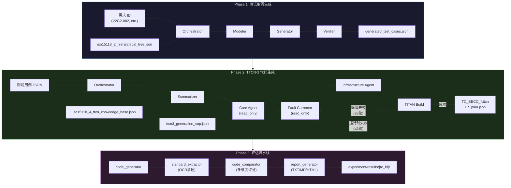

# ISO 15118-2/4 TTCN-3 测试代码自动生成系统

本项目基于 **NeTestLLM** 论文方法论，构建了一个端到端的自动化流水线，将 ISO 15118-2 协议安全需求自动转化为符合 ISO 15118-4 规范的 TTCN-3 一致性测试代码。整个系统以 **Claude Code CLI** 作为核心 Agent 引擎，通过多 Agent 协作模式实现高质量代码生成。

---

## 目录

- [1. 项目概述](#1-项目概述)
- [2. 目录结构](#2-目录结构)
- [3. 快速开始](#3-快速开始)
- [4. 环境配置](#4-环境配置)
- [5. 三阶段流水线详解](#5-三阶段流水线详解)
- [6. 核心模块详解](#6-核心模块详解)
- [7. TTCN-3 代码规范](#7-ttcn-3-代码规范)
- [8. 使用方法](#8-使用方法)
- [9. 常见问题](#9-常见问题)
- [10. 附录](#10-附录)

---

## 1. 项目概述

### 1.1 核心能力

| 阶段 | 输入 | 输出 | Agent 架构 |
|------|------|------|------------|
| **Phase 1** | 安全需求 ID（如 V2G2-082） | 测试用例 JSON（ISO 15118-4 格式） | 4-Agent |
| **Phase 2** | 测试用例 JSON | TTCN-3 代码文件（.ttcn） | 5-Agent（含迭代纠错） |
| **Phase 3** | 生成的 TTCN-3 代码 + 标准参考 | 评估报告（多维度评分） | 4 步流水线 |

### 1.2 技术栈

- **核心引擎**：Claude Code CLI（通过 `claude -p` 调用作为 sub-agent）
- **Agent 架构**：多 Agent 协作（Orchestrator、Summarizer、Core Agent、Verifier/Fault Corrector、Infrastructure Agent）
- **协议数据**：ISO 15118-2 结构化 JSON + ISO 15118-4 TTCN-3 知识库
- **生成语言**：TTCN-3（Testing and Test Control Notation），由 Eclipse TITAN 编译运行
- **协议标准**：ISO 15118-2:2014（需求规范）+ ISO 15118-4:2018（TTCN-3 测试规范）
- **分析方法**：scapy PCAP 抓包 + TITAN TestExecution.log 解析 + 双轨时间对齐

### 1.3 项目文件说明

| 文件 | 用途 |
|------|------|
| `CLAUDE.md` | Claude Code Agent 工作指南（开发参考） |
| `test_code/knowledge_base/` | Phase 2 专用知识库（TTCN-3 SOP + TITAN 错误模式库） |
| `test_case/` | Phase 1：测试用例生成 |
| `test_code/` | Phase 2：TTCN-3 代码生成 |
| `experiment/` | Phase 3：评估流水线 |

---

## 2. 目录结构

```
agent/
├── CLAUDE.md                                    # Claude Code Agent 工作指南（开发参考）
│
├── document/                                    # 协议文档与预处理数据
│   ├── MinerU_markdown_ISO_15118-2-2014_*.md       # ISO 15118-2 原始文档（3分卷）
│   ├── MinerU_markdown_ISO_15118-4-2018_*.md        # ISO 15118-4 原始文档（3分卷）
│   ├── MinerU_markdown_Automated_*.md                # NeTestLLM 论文
│   ├── iso15118_2_hierarchical_tree.json            # ISO 15118-2 结构化知识库
│   ├── iso15118_4_ttcn_knowledge_base.json          # ISO 15118-4 TTCN-3 知识库
│   ├── iso15118_preprocessor.py                     # 基础预处理器
│   ├── iso15118_preprocessor_enhanced.py             # 增强预处理器
│   ├── iso15118_4_preprocessor.py                    # ISO 15118-4 预处理器
│   ├── extract_figures_tables.py                    # 图表/表格提取脚本
│   ├── table/                                     # 提取的表格（table_1.md ~ table_112.md）
│   └── image/                                     # 提取的图表图片（108 figures）
│
├── test_case/                                    # ===== Phase 1: 测试用例生成 =====
│   ├── test_case_generator.py                    # 4-Agent 测试用例生成器
│   ├── generated_test_cases.json                 # 已生成的测试用例样例
│   ├── test_case_TODO.md                        # 重构 TODO 计划
│   ├── output/                                  # 各次运行的独立输出 JSON
│   └── prompts/                                 # Phase 1 Agent Prompt 模板
│       ├── orchestrator_prompt.txt              # Orchestrator（意图分解）
│       ├── modeler_prompt.txt                   # Modeler（低层建模）
│       ├── generator_prompt.txt                 # Generator（测试用例生成）
│       └── verifier_prompt.txt                   # Verifier（覆盖验证）
│
├── test_code/                                   # ===== Phase 2: TTCN-3 代码生成 =====
│   ├── ttcn3_generation_pipeline.py             # 核心流水线（5-Agent, ~7367行）
│   ├── iso15118_4_preprocessor.py               # ISO 15118-4 预处理器
│   ├── prompts/                                 # Phase 2 Agent Prompt 模板
│   │   ├── orchestrator_prompt.txt              # Orchestrator（意图分解）
│   │   ├── summarizer_prompt.txt                # Summarizer（知识检索）
│   │   ├── core_agent_prompt.txt                # Core Agent（TTCN-3 代码生成）
│   │   ├── fault_corrector_prompt.txt           # Fault Corrector（统一纠错 prompt）
│   │   └── infrastructure_agent_prompt.txt      # Infrastructure Agent（TITAN 脚手架）
│   ├── knowledge_base/                          # Phase 2 专用知识库
│   │   ├── ttcn3_generation_sop.json            # TTCN-3 代码生成 SOP（含 common_errors）
│   │   ├── generation_patterns.json              # 代码模式库（从 SOP 提取）
│   │   ├── titan_troubleshooting_db.json        # 结构化编译错误模式库（20+ 条目）
│   │   ├── titan_troubleshooting.md             # TITAN 故障排查手册
│   │   ├── titan_reference_summary.json         # TITAN 编译器错误模式参考摘要
│   │   └── doc_urls.json                       # Eclipse TITAN 官方文档 URL 索引
│   ├── fault_corrector/                         # ===== Fault Corrector 运行时分析 =====
│   │   ├── correlator.py                        # TTCN-3 log + PCAP 时间对齐
│   │   ├── fault_classifier.py                  # 故障分类（6类 + 根因分析）
│   │   ├── pcap_parser.py                       # PCAP V2GTP 报文解析
│   │   ├── repair_engine.py                     # 修复建议生成 + 知识库自学习
│   │   ├── sniffer.py                           # scapy 后台抓包
│   │   └── titan_log_parser.py                  # TITAN TestExecution.log 解析
│   ├── examples/                                # TTCN-3 Few-shot 参考样例
│   │   ├── ttcn3_CANONICAL_testcase.ttcn        # 权威规范测试用例样例
│   │   ├── ttcn3_testcase_goodcase.ttcn         # GoodCase 测试用例样例
│   │   ├── ttcn3_testcase_badcase.ttcn           # BadCase 测试用例样例
│   │   ├── ttcn3_test_behavior_function.ttcn    # 测试行为函数样例
│   │   ├── ttcn3_precondition_function_*.ttcn    # 前置条件函数样例（Init/Binding）
│   │   ├── ttcn3_postcondition_function_*.ttcn   # 后置条件函数样例（InitialState/Shutdown）
│   │   ├── ttcn3_templates.ttcn                 # 消息模板样例
│   │   ├── ttcn3_altstep.ttcn                   # Altstep 样例
│   │   ├── ttcn3_testcase_with_imports.ttcn     # 含完整 import 的测试用例样例
│   │   └── demo/                                # 完整可运行的 TITAN Demo 项目
│   │       ├── README.md                        # Demo 完整说明 + V2G 通信流程
│   │       ├── build.sh                         # 跨平台构建脚本
│   │       ├── config/
│   │       │   ├── titan_runtime.cfg
│   │       │   └── hardware_env.json
│   │       ├── src/ttcn3/                       # 完整 TTCN-3 源码树
│   │       │   ├── 1_Data_Definitions/（PICS, PIXIT, Templates, Types）
│   │       │   ├── 2_Architecture/（ComponentsAndPorts）
│   │       │   ├── 3_Behavior_Steps/（PostConditions, PreConditions, Services, TestBehavior）
│   │       │   └── 4_TestCases/（TestCases_SECC）
│   │       ├── src/cpp_adapters/                # C++ SA/CD 适配器
│   │       │   ├── common/（Common.cc/.hh）
│   │       │   ├── CD/（exi_engine/, titan_tci/）
│   │       │   └── SA/（ports/, titan_tri/, hardware/）
│   │       ├── build/                           # 编译产物（bin/, generated_cpp/, obj/）
│   │       └── logs/                            # TITAN 执行日志
│   └── generated/                               # Phase 2 生成的代码输出目录
│       └── TC_SECC_CMN_VTB_V2GTPHeader_001/   # V2GTPHeader 测试用例完整项目
│           ├── TC_SECC_CMN_VTB_V2GTPHeader_001.ttcn
│           ├── TC_SECC_CMN_VTB_V2GTPHeader_001_plan.json
│           ├── fault_analysis.json
│           ├── build.sh
│           ├── config/
│           ├── src/ttcn3/
│           ├── src/cpp_adapters/
│           └── logs/
│
└── experiment/                                  # ===== Phase 3: 评估流水线 =====
    ├── README.md                               # 实验 Pipeline 说明
    ├── test_cases_config.json                  # 测试用例配置文件
    ├── run_experiment.py                       # Pipeline 主入口
    ├── code_generator.py                       # Phase 2 包装器
    ├── standard_extractor.py                   # 标准参考提取器（含 OCNCleaner）
    ├── code_comparator.py                     # 代码对比分析器（5维度评分）
    ├── evaluation_pipeline.py                 # 端到端评估 Pipeline
    ├── report_generator.py                    # 报告生成器（TXT/MD/HTML）
    ├── batch_runner.py                        # 批量测试运行器
    ├── ocn_cleaner_patterns.json              # OCR 错误修复模式库
    ├── standard_references/                    # 提取的标准参考代码（输出）
    ├── comparison_results/                    # 对比结果（输出）
    ├── results/                               # 实验结果目录（输出）
    │   └── TC_SECC_CMN_VTB_*/
    │       ├── comparison_report.txt
    │       ├── standard_data.json
    │       ├── summary.json
    │       └── experiment_result.json
    ├── reports/                               # 生成的报告（输出）
    └── logs/                                 # 实验日志
```

---

## 3. 快速开始

### 3.1 最小环境要求（仅生成代码）

只需两项配置即可开始生成 TTCN-3 测试代码：

**1. Python 3.8+**

```bash
python --version
```

**2. Claude Code CLI + API Key**

```bash
# 安装
npm install -g @anthropic-ai/claude-code

# 配置 API Key
export ANTHROPIC_API_KEY="sk-ant-xxxxx-your-key-here"

# 验证
claude --version
```

### 3.2 快速路径一：直接通过安全需求生成（推荐）

```bash
# 仅生成 TTCN-3 代码（不含项目结构）
python test_code/ttcn3_generation_pipeline.py --requirement V2G2-082

# 生成完整 TITAN 项目结构（config + cpp_adapters + build.sh + 编译运行）
python test_code/ttcn3_generation_pipeline.py --requirement V2G2-082 --with-infrastructure

# 生成项目结构但跳过编译（仅脚手架）
python test_code/ttcn3_generation_pipeline.py --requirement V2G2-082 --with-infrastructure --skip-build

# 指定 SUT IP（用于 titan_runtime.cfg，默认 IPv6 组播 ff02::01）
python test_code/ttcn3_generation_pipeline.py --requirement V2G2-082 --with-infrastructure --sut-ip 192.168.1.100

# 运行 Phase 3 评估
cd experiment
python run_experiment.py --tc-id TC_SECC_CMN_VTB_V2GTPHeader_001
```

### 3.3 快速路径二：手动控制流水线

```bash
# Phase 1: 生成测试用例
python test_case/test_case_generator.py --requirements V2G2-082

# Phase 2: 生成 TTCN-3 代码
python test_code/ttcn3_generation_pipeline.py --requirement V2G2-082

# Phase 3: 评估代码质量
cd experiment
python run_experiment.py --tc-id TC_SECC_CMN_VTB_V2GTPHeader_001
```

### 3.4 完整配置（生成 + 编译 + 运行）

在最小配置基础上增加：

```bash
# Linux
sudo apt update
sudo apt install eclipse-titan build-essential

# Windows（推荐 WSL）
wsl --install -d Ubuntu
# 然后在 WSL 中执行上面的 Linux 命令
```

---

## 4. 环境配置

### 4.1 Claude Code CLI 安装与配置

**Windows（PowerShell）：**

```powershell
# 方法一：npm 安装
npm install -g @anthropic-ai/claude-code

# 方法二：winget 安装
winget install Anthropic.ClaudeCode

# 方法三：直接下载可执行文件
# 访问 https://github.com/anthropics/claude-code/releases 下载最新 release
```

**Linux/macOS：**

```bash
# 方法一：npm 安装（跨平台）
npm install -g @anthropic-ai/claude-code

# 方法二：curl 一键安装
curl -fsSL https://github.com/anthropics/claude-code/releases/latest/download/claude-code.sh | bash
```

**API Key 配置：**

```powershell
# PowerShell
$env:ANTHROPIC_API_KEY = "sk-ant-xxxxx-xxxxxxxxxxxxx"

# Linux/macOS Bash
export ANTHROPIC_API_KEY="sk-ant-xxxxx-xxxxxxxxxxxxx"
```

验证安装：

```bash
claude --version
```

### 4.2 Python 环境配置

`agent/` 模块**仅依赖 Python 标准库**，无需安装任何第三方 Python 包。

```bash
# 方式一：使用系统 Python
python --version  # 3.8+ 即可

# 方式二：虚拟环境（推荐）
python -m venv venv
source venv/bin/activate  # Linux/macOS
.\venv\Scripts\Activate   # Windows PowerShell

# 方式三：conda
conda create -n platform python=3.11 -y
conda activate platform
```

### 4.3 Eclipse TITAN 安装（可选，仅编译运行需要）

Eclipse TITAN 是唯一官方支持的 TTCN-3 编译器和运行时。

**Linux（Ubuntu/Debian，apt 一键安装）：**

```bash
# 1. 更新本地软件源索引
sudo apt update

# 2. 一键安装 Eclipse TITAN 及核心组件
sudo apt install eclipse-titan

# 3. 验证
makefilegen --version
ttcn3-compiler --version
```

**Linux（从源码编译，获取最新版本）：**

```bash
sudo apt install git cmake g++ libxml2-dev libssl-dev libncurses-dev
git clone https://github.com/eclipse/titan.git
cd titan
./bootstrap
./configure --prefix=$HOME/TITAN
make -j$(nproc)
make install

# 配置环境变量
nano ~/.bashrc
# 添加：
export TTCN3_DIR=$HOME/TITAN
export PATH=$TTCN3_DIR/bin:$PATH
export LD_LIBRARY_PATH=$TTCN3_DIR/lib:$LD_LIBRARY_PATH
source ~/.bashrc

# 验证
makefilegen --version
ttcn3-compiler --version
```

**Windows：**

TITAN 在 Windows 上需要通过 WSL 运行（推荐）：

```powershell
wsl --install -d Ubuntu
# 然后在 WSL 中执行上面的 Linux 安装命令
```

### 4.4 环境变量速查

| 变量名 | 说明 | 必须模块 |
|--------|------|----------|
| `ANTHROPIC_API_KEY` | Anthropic API Key | agent/（Phase 1/2/3） |
| `TTCN3_DIR` | TITAN 安装根目录（如 `$HOME/TITAN`） | 源码编译安装后 |
| `PATH` | 包含 `$TTCN3_DIR/bin` | demo/（编译运行） |
| `LD_LIBRARY_PATH` | 包含 `$TTCN3_DIR/lib` | demo/（编译运行） |

> **apt 安装说明**：通过 `sudo apt install eclipse-titan` 安装时，TITAN 默认安装到 `/usr`，bin 目录已在 `PATH` 中，无需额外配置环境变量。

---

## 5. 三阶段流水线详解

### 5.1 整体数据流



> **注意**：静态检查循环已被移除。TITAN 编译器已覆盖语法/命名/定时器等全部检查项，无需额外的 LLM 静态审查阶段。唯一的反馈回路为编译循环和运行时循环，两者均以真实构建/运行结果为驱动。

### 5.2 Phase 1：测试用例生成（4-Agent）

脚本：`test_case/test_case_generator.py`

输入：安全需求 ID（如 V2G2-082）→ 输出：ISO 15118-4 格式测试用例 JSON

| Agent | 职责 | Prompt 模板 |
|-------|------|-------------|
| **Orchestrator** | 意图分解：解析单/多需求，确定 SUT/消息类型/测试类型 | `orchestrator_prompt.txt` |
| **Modeler** | 低层建模：提取 Packet Field / FSM / Time Sequence / Functional testing points | `modeler_prompt.txt` |
| **Generator** | 测试用例生成：遍历 testing points，生成 ISO 15118-4 格式 JSON | `generator_prompt.txt` |
| **Verifier** | 覆盖验证：breadth + depth 评分，不足时反馈 Generator 补充 | `verifier_prompt.txt` |

### 5.3 Phase 2：TTCN-3 代码生成（5-Agent + 双反馈回路）

脚本：`test_code/ttcn3_generation_pipeline.py`

输入：测试用例 JSON → 输出：完整的 TTCN-3 .ttcn 文件（含 TITAN 项目脚手架）

**Agent 架构（重要安全设计）：**

| Agent | 职责 | Prompt 模板 | 工具权限 |
|-------|------|-------------|---------|
| **Orchestrator** | 意图分解：测试用例 JSON → generation_plan | `orchestrator_prompt.txt` | **Read-only** |
| **Summarizer** | 知识检索：从 iso15118_4_ttcn_knowledge_base.json 检索参考代码 | `summarizer_prompt.txt` | **Read-only** |
| **Core Agent** | 代码生成：基于 generation_plan + Few-shot + SOP，生成完整 TTCN-3 模块 | `core_agent_prompt.txt` | **Read-only** |
| **Fault Corrector** | compile 模式（LLM + titan_troubleshooting_db.json）/ runtime 模式（Python 双轨分析） | `fault_corrector_prompt.txt` | **Read-only** |
| **Infrastructure Agent** | 项目脚手架：生成完整 TITAN 项目结构（config、TTCN-3 骨架、C++ 适配器目录） | `infrastructure_agent_prompt.txt` | **Write/Edit/Bash** |

> **安全设计**：Orchestrator、Summarizer、Core Agent、Fault Corrector 均以 `read_only=True` 运行，`--allowedTools` 仅包含 `Read`，禁止写入磁盘，确保只输出 JSON 文本。Infrastructure Agent 保留完整工具权限以写入项目文件。

**双反馈回路（均以真实构建/运行结果为驱动）：**

- **编译循环**（≤3 轮）：TITAN 编译失败 → Fault Corrector(compile) → Core Agent + Infrastructure Agent 重试
- **运行时循环**（≤2 轮）：测试执行失败 → Fault Corrector(runtime) → auto_fix（确定性修复）/ manual_review

**Prompt 大小配置：**

| 阈值 | 值 | 说明 |
|------|-----|------|
| `PROMPT_SIZE_WARNING` | 80KB | 超过后记录 WARN 日志 |
| `PROMPT_SIZE_HARD` | 100KB | 超过后记录 ERROR 日志（但不截断） |

> 阈值已提高以支持丰富的 Few-shot 示例注入，避免误报。

### 5.4 Phase 3：评估流水线（4 步）

脚本：`experiment/run_experiment.py`

| 步骤 | 模块 | 职责 |
|------|------|------|
| **Step 1** | `code_generator.py` | 调用 Phase 2 生成 TTCN-3 代码 |
| **Step 2** | `standard_extractor.py` | 从 iso15118_4_ttcn_knowledge_base.json 提取标准参考（含 OCNCleaner OCR 修复） |
| **Step 3** | `code_comparator.py` | 多维度评分：结构 30%、语法 25%、语义 25%、命名 10%、完整性 10% |
| **Step 4** | `report_generator.py` | 生成 TXT / Markdown / HTML 多格式报告 |

---

## 6. 核心模块详解

### 6.1 Fault Corrector 运行时分析模块

位于 `test_code/fault_corrector/`，用于 Phase 2 的运行时诊断：

| 模块 | 职责 |
|------|------|
| `sniffer.py` | `V2G_Sniffer`：scapy 后台抓包，监听 V2G 端口，输出 PCAP 文件 |
| `pcap_parser.py` | `VGTP_Packet`、`PcapParser`：解析 PCAP → V2GTP 消息序列（protocolVersion、payloadType 等） |
| `titan_log_parser.py` | `TitanLogParser`、`TitanLogEntry`：解析 TITAN `TestExecution.log` → 结构化事件（timer、port send/receive、verdict） |
| `correlator.py` | `CorrelatedEvent`、`AlignmentResult`：时间对齐 TTCN-3 log 事件与 PCAP 报文，报告分歧点 |
| `fault_classifier.py` | `FaultResult`：6 类故障分类（timeout、port_mismatch、template_field_error、v2gtp_header_error、precondition_not_met、pcap_only_error） |
| `repair_engine.py` | `RepairEngine`：生成 auto_fix（确定性修复）或 manual_review（语义级修复），支持自学习并追加到 titan_troubleshooting_db.json |

### 6.2 Knowledge Base

位于 `test_code/knowledge_base/`：

| 文件 | 用途 |
|------|------|
| `ttcn3_generation_sop.json` | 7 步 SOP + 前置条件链 + 命名规范 + 输出结构 + common_errors（含 odd-hex-digits 修复指南） |
| `generation_patterns.json` | 代码模式库（从 SOP 提取，含 canonical_exi_payload = 140字节有效 SupportedAppProtocolReq EXI） |
| `titan_troubleshooting_db.json` | 结构化编译错误模式库（20+ 条目，含 port_undefined、import_missing、runs_on_mismatch 等） |
| `titan_troubleshooting.md` | TITAN 故障排查手册（人类可读） |
| `titan_reference_summary.json` | TITAN 编译器 check/syntax/build 错误模式参考 |
| `doc_urls.json` | Eclipse TITAN 官方文档 URL 索引 |

**EXI 有效载荷规范：**

> 所有生成的 TTCN-3 代码必须使用真实、完整、有效的 ISO 15118-2 EXI 编码作为 SupportedAppProtocolReq 有效载荷。canonical_exi_payload 为 140 字节（280 个十六进制字符）：
> `'8000EBAB9371D34B9B79D189A98989C1D191D191818999D26B9B3A232B30020000000001B75726E3A64696E3A37303132313A323031323A4D73674465660040000000880000'O`
>
> **关键约束**：TTCN-3 要求 octetstring 的十六进制字符数必须为偶数。若原始 EXI 字符串长度为奇数，必须在末尾追加 '0' 或 '00' 使其长度为偶数后编译。详见 `common_errors` 中的 "Octetstring value contains odd number of hexadecimal digits" 条目。

### 6.3 实验评估模块

位于 `experiment/`：

| 模块 | 职责 |
|------|------|
| `standard_extractor.py` | `KnowledgeBaseLoader`（缓存）、`StandardReferenceExtractor`（提取组件）、`OCNCleaner`（修复 OCR 错误，如 `v HAL_61851 Listener` → `v_HAL_61851_Listener`）、`TCIDParser`（解析 3 种 TC ID 格式）、`ReferenceFormatter` |
| `code_comparator.py` | `TTCN3Parser`（正则解析代码结构）、`NamingConventionChecker`（ISO 15118-4 命名规则）、`SemanticAnalyzer`（必需/推荐组件分析）、`CodeComparator`（difflib 相似度）、`ComparisonAnalyzer`（5 维度综合评分） |
| `report_generator.py` | `TextReportGenerator`（纯文本）、`MarkdownReportGenerator`（Markdown）、`HTMLReportGenerator`（带进度条可视化） |
| `evaluation_pipeline.py` | 端到端状态机，`StepStatus` 枚举，支持 `--extract-only`、`--compare-only` |
| `batch_runner.py` | 并行/串行执行、增量运行（跳过已成功）、状态持久化、JSON/CSV 导出 |

---

## 7. TTCN-3 代码规范

### 7.1 命名规范（ISO 15118-4）

| 类型 | 命名模式 | 示例 |
|------|----------|------|
| **testcase** | `TC_{SUT}_{Category}_VTB_{MessageType}_{SeqNo}` | `TC_SECC_CMN_VTB_SessionSetup_001` |
| **测试行为函数** | `f_{SUT}_{Category}_TB_VTB_{MessageType}_{SeqNo}` | `f_SECC_CMN_TB_VTB_SessionSetup_001` |
| **前置条件函数** | `f_{SUT}_{Category}_PR_{Name}_{SeqNo}` | `f_SECC_CMN_PR_SessionSetup_001` |
| **后置条件函数** | `f_{SUT}_{Category}_PO_{Name}_{SeqNo}` | `f_SECC_CMN_PO_InitConfiguration_001` |
| **发送模板** | `md_CMN_{MessageType}_{SeqNo}` | `md_CMN_SessionSetupReq_001` |
| **接收模板** | `mdw_{SUT}_{MessageType}_{SeqNo}` | `mdw_SECC_SessionSetupRes_001` |
| **Altstep** | `a_{SUT}_{Name}` | `a_SECC_Unexpected_V2G_Message` |
| **计时器** | `tc_V2G_{SUT}_Msg_Timer` | `tc_V2G_EVCC_Msg_Timer` |
| **组件变量** | `vc_{Name}` | `vc_SessionID` |

**参数说明：**
- **SUT**：`SECC` 或 `EVCC`
- **Category**：`CMN`（通用）、`AC`（交流）、`DC`（直流）
- **SeqNo**：3 位数字，`001` = GoodCase，`002`+ = BadCase

### 7.2 四阶段测试执行模型

```
Phase A: Initialize (f_*_PR_InitConfiguration_001)
  - 创建 PTC
  - 映射端口
  - 初始化组件变量
Phase B: Precondition (协议特定的前置条件链)
  - 将 SUT 带到已知状态
  - SDP → SupportedAppProtocol → SessionSetup → ...
Phase C: Test Behavior (f_*_TB_VTB_* + alt 块)
  - 发送激励
  - 验证响应
  - 设置 verdict
Phase D: Postcondition (f_*_PO_*_001)
  - 清理
  - 取消端口映射
```

### 7.3 GoodCase vs BadCase

| 类型 | SeqNo | 描述 | pass 条件 |
|------|-------|------|-----------|
| **GoodCase** | 001 | 发送有效消息，期望正确响应 | 收到正确响应则 pass |
| **BadCase** | 002+ | 发送无效消息，期望拒绝/关闭/超时 | SUT 拒绝/关闭/超时则 pass |

### 7.4 V2GTP 头部常量

| 字段 | 值 | 描述 |
|------|-----|------|
| protocolVersion | `'01'H` | 协议版本 |
| invProtocolVersion | `'FE'H` | 协议版本取反 |
| payloadType | `'8001'H` | V2G 消息载荷 |

### 7.5 前置条件链（按协议消息顺序）

```
SDP → SupportedAppProtocol → SessionSetup → ServiceDiscovery
→ PaymentServiceSelection → Authorization → ChargeParameterDiscovery
→ PowerDelivery → ChargingStatus/CurrentDemand → SessionStop
```

完整定义见 `test_code/knowledge_base/ttcn3_generation_sop.json` 的 `precondition_chains` 字段。

### 7.6 关键注意事项

1. **每个 alt 分支都必须停止定时器**（`tc_*.stop`），超时分支除外
2. **测试行为函数必须以 `return getverdict;` 结尾**
3. **模板字段语义**：`omit` 表示字段不存在；`?` 表示任意值；`*` 表示可选字段
4. **所有生成的代码必须包含需求追溯注释**（`@reference` 标注 V2G2-XXX）
5. **EXI 有效载荷必须完整**：不得截断 EXI 字符串，必须使用完整的 140 字节有效载荷
6. **octetstring 十六进制字符数必须为偶数**：若原始 EXI 长度为奇数，在末尾追加 '0' 或 '00'
7. **参考 `test_code/examples/` 目录下的 .ttcn 文件作为代码风格参考**

---

## 8. 使用方法

### 8.1 Phase 1 命令行用法

```bash
# 单需求模式（每个需求独立生成）
python test_case/test_case_generator.py --requirements V2G2-082 --mode single

# 多需求合并模式（多需求合并为一个测试用例）
python test_case/test_case_generator.py --requirements V2G2-082,V2G2-083,V2G2-084 --mode multi

# 跳过验证步骤（加速）
python test_case/test_case_generator.py --requirements V2G2-082 --skip-verify

# 指定输出目录
python test_case/test_case_generator.py --requirements V2G2-082 --output-dir ./custom_output
```

### 8.2 Phase 2 命令行用法（4 种输入模式）

所有参数分为以下几组，必须指定**输入模式**之一：

```bash
# ===== 输入模式（必须选择其中一种）=====
# 模式 1: 通过安全需求 ID
python test_code/ttcn3_generation_pipeline.py --requirement V2G2-082

# 指定 SUT 类型
python test_code/ttcn3_generation_pipeline.py --requirement V2G2-082 --sut SECC

# 多个安全需求 → 合并为一个测试用例（默认 multi 模式）
python test_code/ttcn3_generation_pipeline.py --requirements V2G2-082,V2G2-165,V2G2-434

# 多个安全需求 → 每个需求单独生成（single 模式）
python test_code/ttcn3_generation_pipeline.py --requirements V2G2-082,V2G2-165 --mode single

# 模式 2: 通过测试用例 ID
python test_code/ttcn3_generation_pipeline.py --tc-id TC_SECC_CMN_VTB_V2GTPHeader_001

# 模式 3: 直接传入测试用例 JSON
python test_code/ttcn3_generation_pipeline.py --test-case '{"Test_Case": {...}}'

# 模式 4: 从文件读取测试用例
python test_code/ttcn3_generation_pipeline.py --test-case-file ./my_test_case.json

# ===== 配置选项 =====
# 指定输出目录
python test_code/ttcn3_generation_pipeline.py --requirement V2G2-082 --output-dir ./generated/

# 未找到测试用例时不自动触发 Phase 1
python test_code/ttcn3_generation_pipeline.py --requirement V2G2-082 --no-auto-generate

# ===== 完整项目结构（Infrastructure Agent）=====
# 生成完整 TITAN 项目结构并执行编译运行
python test_code/ttcn3_generation_pipeline.py --requirement V2G2-082 --with-infrastructure

# 生成项目结构但跳过编译（仅生成脚手架）
python test_code/ttcn3_generation_pipeline.py --requirement V2G2-082 --with-infrastructure --skip-build

# 指定 SUT IP（用于 titan_runtime.cfg，默认 IPv6 组播 ff02::01）
python test_code/ttcn3_generation_pipeline.py --requirement V2G2-082 --with-infrastructure --sut-ip 192.168.1.100

# ===== 故障分析（Fault Agent 双轨分析）=====
# 指定 TITAN 执行日志路径（用于 Fault Agent 分析）
python test_code/ttcn3_generation_pipeline.py --requirement V2G2-082 --titan-log ./logs/TestExecution.log

# 指定 PCAP 文件路径（用于 Fault Agent 双轨分析）
python test_code/ttcn3_generation_pipeline.py --requirement V2G2-082 --pcap ./captures/v2g_session.pcap
```

**参数说明：**

| 参数 | 说明 |
|------|------|
| `--requirement` | 单个安全需求 ID（如 V2G2-082） |
| `--requirements` | 多个安全需求 ID，逗号分隔 |
| `--tc-id` | 测试用例 ID（如 TC_SECC_CMN_VTB_V2GTPHeader_001） |
| `--test-case` | 测试用例 JSON 字符串 |
| `--test-case-file` | 测试用例 JSON 文件路径 |
| `--sut` | SUT 类型：`SECC` 或 `EVCC` |
| `--mode` | 生成模式：`single`（每需求单独生成）或 `multi`（多需求合并） |
| `--output-dir` | 指定输出目录（默认 `test_code/generated/`） |
| `--no-auto-generate` | 未找到测试用例时不自动生成 |
| `--with-infrastructure` | 生成完整 TITAN 项目结构并执行编译运行 |
| `--skip-build` | 配合 `--with-infrastructure`：仅生成脚手架，跳过编译运行 |
| `--sut-ip` | SUT IP 地址（用于 `titan_runtime.cfg`，默认 `ff02::01` IPv6 组播） |
| `--titan-log` | TITAN `TestExecution.log` 路径（用于 Fault Agent 分析） |
| `--pcap` | PCAP 文件路径（用于 Fault Agent 双轨分析） |

### 8.3 Phase 3 命令行用法

```bash
cd experiment

# 单个测试用例完整流程（代码生成 + 标准提取 + 对比 + 报告）
python run_experiment.py --tc-id TC_SECC_CMN_VTB_V2GTPHeader_001

# 跳过代码生成（使用已有代码）
python run_experiment.py --tc-id TC_SECC_CMN_VTB_V2GTPHeader_001 --skip-generation

# 覆盖已有结果
python run_experiment.py --tc-id TC_SECC_CMN_VTB_V2GTPHeader_001 --overwrite

# 批量测试（从配置文件读取测试用例列表）
python run_experiment.py --batch
python run_experiment.py --batch --config ./test_cases_config.json

# 仅运行对比
python run_experiment.py --compare-only \
    --generated /path/to/generated.ttcn \
    --standard /path/to/standard.ttcn \
    --tc-id TC_SECC_CMN_VTB_V2GTPHeader_001
```

### 8.4 批量测试配置

编辑 `experiment/test_cases_config.json`：

```json
{
  "single_test": {
    "enabled": true,
    "test_case": {
      "tc_id": "TC_SECC_CMN_VTB_V2GTPHeader_001",
      "description": "SECC V2GTP Header GoodCase"
    }
  },
  "batch_test": {
    "enabled": false,
    "test_cases": [
      {"tc_id": "TC_SECC_CMN_VTB_SessionSetup_001"},
      {"tc_id": "TC_SECC_CMN_VTB_V2GTPHeader_001"}
    ]
  },
  "pipeline_config": {
    "steps": {
      "code_generation": {"enabled": true},
      "standard_extraction": {"enabled": true},
      "code_comparison": {"enabled": true},
      "report_generation": {"enabled": true}
    },
    "results_dir": "./results"
  }
}
```

### 8.5 批量运行器

```bash
# 运行所有测试
python batch_runner.py --run-all

# 并行执行
python batch_runner.py --run-all --parallel --workers 4

# 增量运行（跳过已成功的）
python batch_runner.py --run-all --incremental

# 查看状态
python batch_runner.py --status

# 导出结果
python batch_runner.py --export ./results.csv --export-format csv
```

---

## 9. 常见问题

### Q1: Claude Code CLI 安装失败？

```powershell
# Windows PowerShell 以管理员身份运行
Set-ExecutionPolicy -ExecutionPolicy RemoteSigned -Scope CurrentUser
irm https://www.nuget.org/api/v2/package/claude-code | iex
```

### Q2: API Key 无效或未配置？

确保环境变量已设置：

```bash
export ANTHROPIC_API_KEY="sk-ant-xxxxx-xxxxxxxxxxxxx"
```

### Q3: TITAN `makefilegen` 找不到？

确保 TITAN 的 bin 目录在 `PATH` 环境变量中：

```bash
# apt 安装（TITAN 默认在 /usr/bin，无需配置）
which makefilegen

# 源码安装（$TTCN3_DIR 默认 $HOME/TITAN）
export PATH="$TTCN3_DIR/bin:$PATH"
```

### Q4: `libttcn3-parallel-dynamic` 链接错误？

```bash
sudo apt install libttcn3-parallel-dynamic
```

### Q5: Python 版本兼容性？

| 模块 | Python 版本要求 |
|------|----------------|
| agent/（Phase 1/2/3） | Python 3.8+（仅标准库） |

### Q6: 标准代码提取失败？

检查知识库文件是否存在：

```bash
ls -la ../document/iso15118_4_ttcn_knowledge_base.json
```

### Q7: 代码生成超时？

可通过修改 `experiment/code_generator.py` 中的 `timeout` 参数调整。

### Q8: "Octetstring value contains odd number of hexadecimal digits" 编译错误？

在 TTCN-3 中，octetstring 的十六进制字符数必须为偶数。若原始 EXI 有效载荷的十六进制字符串长度为奇数，必须在末尾追加 `'0'` 或 `'00'` 使其长度为偶数后再编译。详见 `test_code/knowledge_base/ttcn3_generation_sop.json` 的 `common_errors` 条目。

### Q9: SECC 模拟器抛出 `java.io.EOFException: Premature EOS`？

确保 EXI 有效载荷是完整的 140 字节（280 个十六进制字符）。不得截断 EXI 字符串，否则 SECC EXI 解码器会因提前遇到 EOS 而抛出异常。

---

## 10. 附录

### 10.1 评分体系

Pipeline 使用多维度评分体系评估代码质量：

| 维度 | 权重 | 说明 |
|------|------|------|
| 结构相似度 | 30% | module、import、testcase 等元素的存在性 |
| 语法正确性 | 25% | alt 块、定时器、verdict 等关键语法 |
| 语义覆盖率 | 25% | 必需组件（testcase/runs on/system/setverdict）存在性 |
| 命名规范度 | 10% | 元素命名是否符合 ISO 15118-4 规范 |
| 代码完整性 | 10% | 缺失/多余的函数、模板等 |

评分等级：

| 等级 | 分数范围 | 描述 |
|------|----------|------|
| 优秀 | 90-100 | 代码质量与标准高度一致 |
| 良好 | 70-89 | 存在少量差异，可小幅优化 |
| 一般 | 50-69 | 需要关注问题并进行修复 |
| 较差 | 0-49 | 建议重新生成 |

### 10.2 数据依赖关系

```
document/iso15118_2_hierarchical_tree.json  ──► Phase 1 ──► generated_test_cases.json
                                                                         │
document/iso15118_4_ttcn_knowledge_base.json ──┬──► Phase 2 ──► TC_SECC_*.ttcn
                                                  │              │
test_code/knowledge_base/ttcn3_generation_sop.json ──► Core Agent   │
test_code/knowledge_base/generation_patterns.json ──► Core Agent    │
test_code/knowledge_base/titan_troubleshooting_db.json ──► FC(compile)  │
test_code/examples/*.ttcn ──► Core Agent (few-shot)                  │
test_code/examples/demo/ ──► Infrastructure Agent (scaffold ref)      │
                                                                       │
TC_SECC_*.ttcn ──► Phase 3 ──► experiment/results/{tc_id}/
```

### 10.3 Eclipse TITAN 官方文档

| 文档 | 链接 |
|------|------|
| User Guide（编译流程） | `doc_urls.json` 中的 `build_reference` 条目 |
| Reference Guide（语言参考） | 8-t_alt_blocks_and_timers.adoc 等 |
| Tips & Troubleshooting | 12-tips_&_troubleshooting.adoc |
| Installation Guide | installationguide.adoc |

详见 `test_code/knowledge_base/doc_urls.json`。

### 10.4 参考资料

- **NeTestLLM 论文**：`document/MinerU_markdown_Automated_Network_Protocol_Testing_with_LLM_Agent_*.md`
- **ISO 15118-2:2014**：协议需求规范
- **ISO 15118-4:2018**：TTCN-3 测试规范
- **Eclipse TITAN**：https://github.com/eclipse/titan

---

## 维护信息

- **Pipeline 版本**：1.3（双 Agent 错误分类 + Read-only Agent 安全加固）
- **创建日期**：2026-04-10
- **更新日期**：2026-05-18
- **依赖**：Python 3.8+（仅标准库），Claude Code CLI
- **文档编码**：UTF-8
